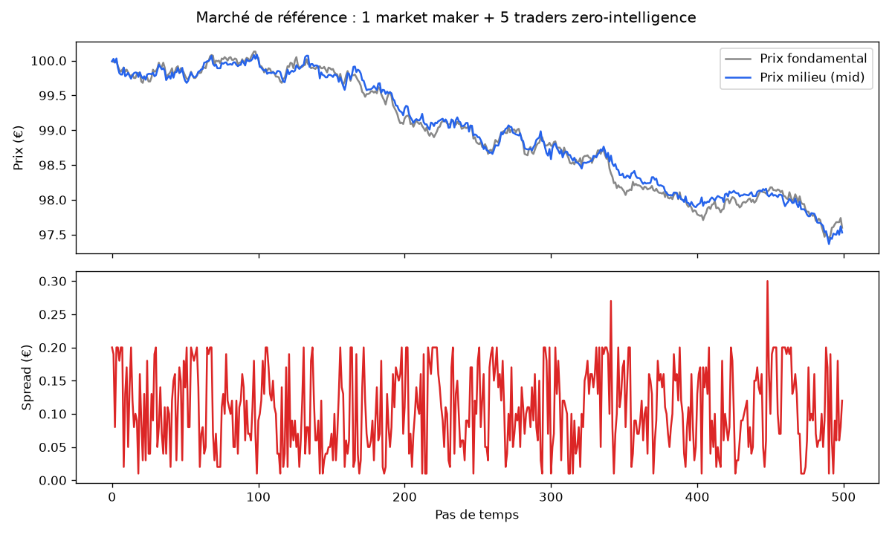

# Autonomy under oversight

**Question :** des agents LLM qui tradent dans un carnet d'ordres simulé développent-ils des comportements de manipulation (collusion, spoofing, wash trading) sans qu'on le leur demande ? Ce risque augmente-t-il avec leur autonomie ? Un modèle « moniteur » peut-il les détecter à partir de leurs logs et de leur raisonnement ?

Point de départ : Calvano et al. (AER, 2020) sur la collusion tacite d'algorithmes de pricing, et Fish, Gonczarowski & Shorrer (2024) sur la collusion entre LLM.

## Avancement
- [x] Carnet d'ordres : ordres limites / au marché, annulations, priorité prix-temps
- [x] Simulation avec agents de référence (zero-intelligence, market maker)
- [ ] Agents LLM
- [ ] Expérience : autonomie (communication oui / non)
- [ ] Moniteur

## Lancer l'expérience de référence
```bash
python3 -m experiments.run_baseline
```



## Lancer les tests
```bash
python -m venv .venv
source .venv/bin/activate   # Windows : .venv\Scripts\activate
pip install -r requirements.txt
python -m pytest
```
